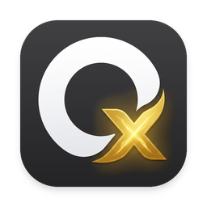
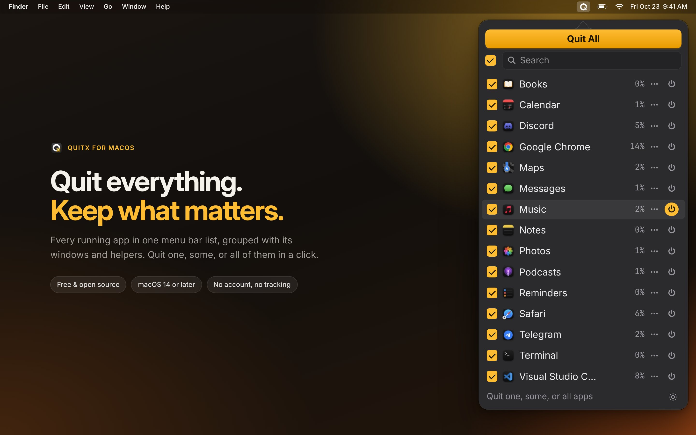
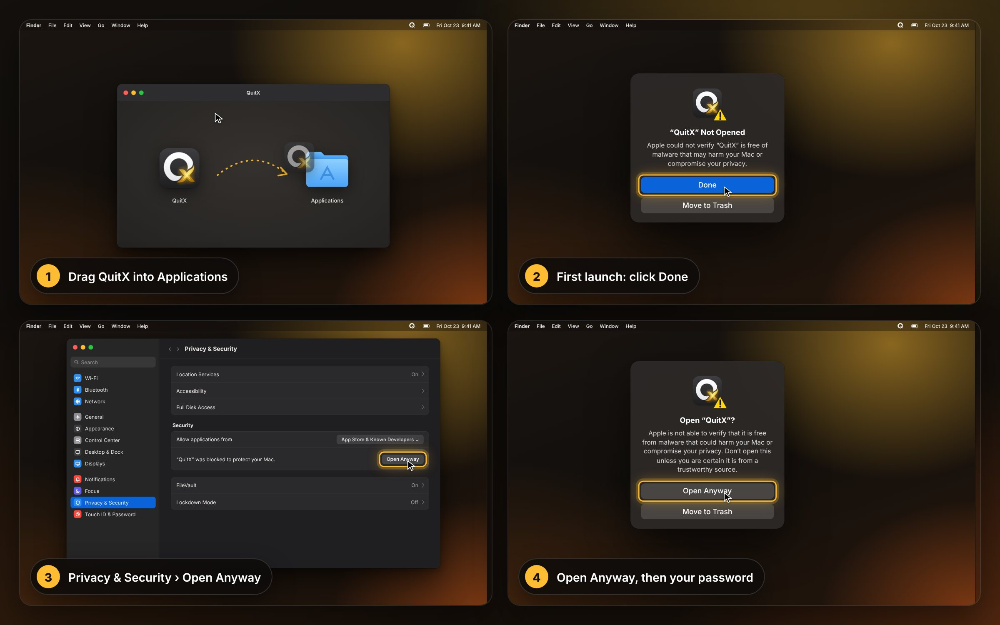

<p align="center">
  
</p>

<h1 align="center">QuitX for macOS</h1>

<p align="center">
  Fast, minimal menu bar companion to quit, force quit, and manage running macOS apps.
</p>

<p align="center">
  <a href="https://github.com/kiron0/quitx/actions/workflows/ci.yml"></a>
  
  
  <a href="LICENSE"></a>
</p>

<p align="center">
  <a href="https://github.com/kiron0/quitx/releases/latest">
    
  </a>
</p>

<p align="center"><a href="https://quitx.kiron.dev">quitx.kiron.dev</a></p>

---

<p align="center">
  
</p>

## Features

- Quit one, selected, or all apps normally or by force.
- Group app instances, windows, helpers, and optional background apps.
- Exclude protected apps; automate quits by inactivity, timer, sleep, or last window.
- Monitor CPU, memory, GPU, battery, and listening ports from the menu bar.
- Warn about sustained CPU or memory pressure and rescue inactive apps.
- Uninstall apps with reviewable leftovers, moved safely to the Trash.
- Use global shortcuts, Classic or Liquid Glass themes, and verified in-app updates.

## How it works

Architecture, macOS APIs, safety rules, permissions, ports, updates, and release details live in [docs/HOW-IT-WORKS.md](docs/HOW-IT-WORKS.md).

## Install

QuitX isn't notarized by Apple (that needs a paid developer account), so macOS asks you to confirm it once. Full walkthrough with screenshots: [quitx.kiron.dev/#install](https://quitx.kiron.dev/#install).

**Terminal** (no prompt): checks the SHA-256 checksum and code signature, installs in `/Applications`, opens QuitX. Don't use `sudo`. [Read the script](site/install).

```bash
curl -fsSL https://quitx.kiron.dev/install | bash
```

**Download**

1. Get the `.dmg` from [Releases](https://github.com/kiron0/quitx/releases/latest) and drag **QuitX** into Applications.
2. Open QuitX. At **“QuitX” Not Opened**, click **Done**.
3. **System Settings › Privacy & Security** › **Open Anyway**, then **Open Anyway** again and your password. On macOS 14, Control-click QuitX › **Open** instead.

<p align="center"></p>

QuitX then updates itself from GitHub Releases (Settings › General).

Support development: [Buy me a coffee](https://buymeacoffee.com/_thk).

## License

MIT © [Toufiq Hasan Kiron](https://github.com/kiron0)
