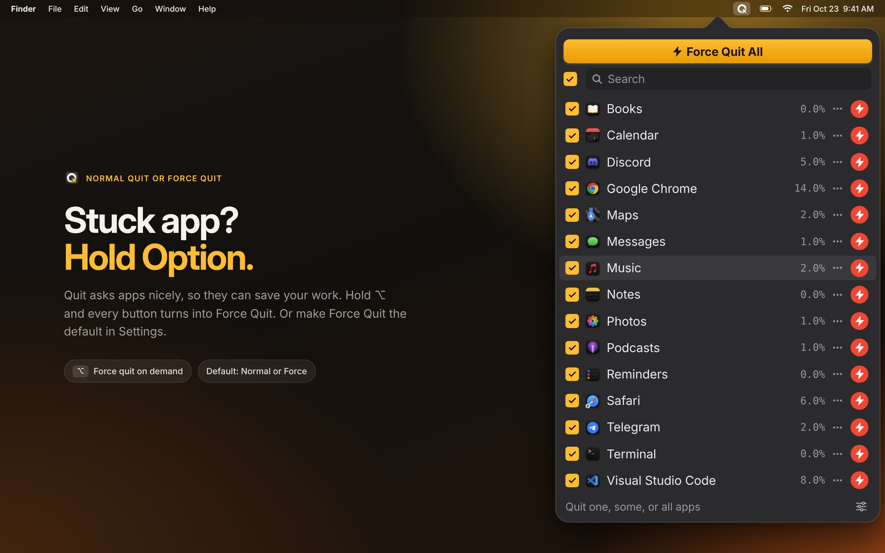
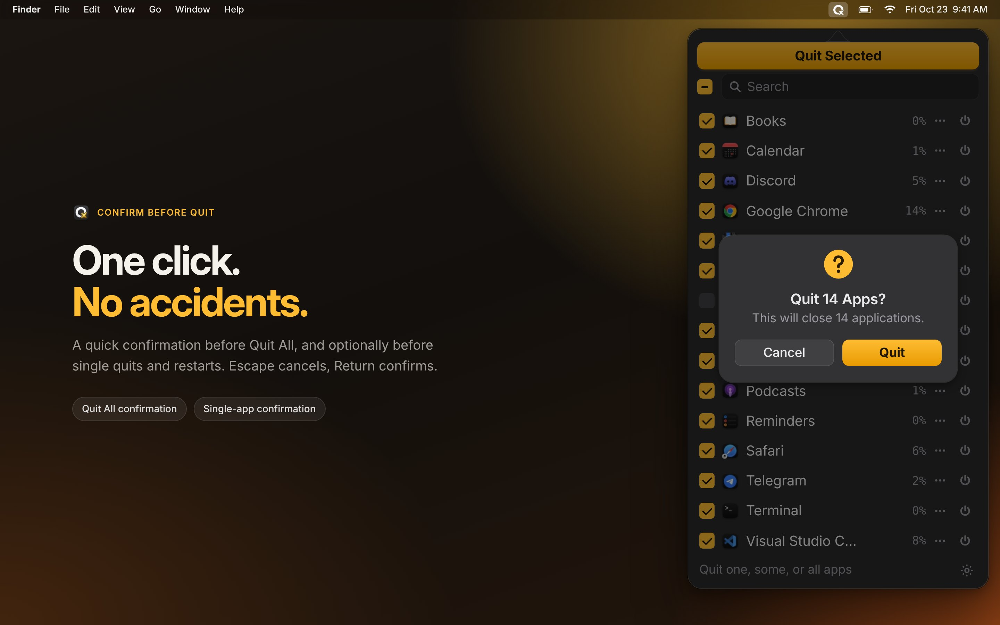
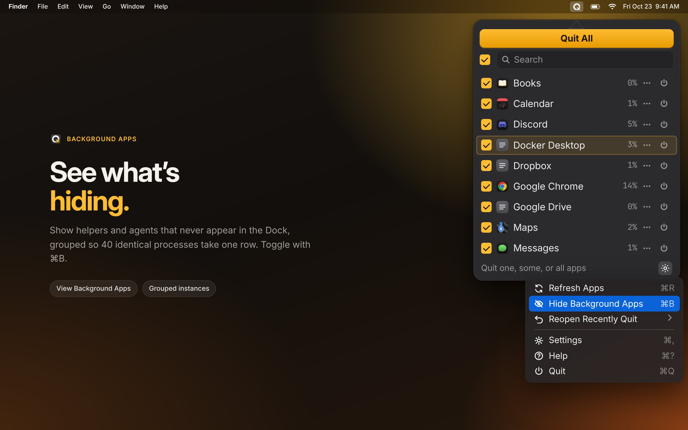
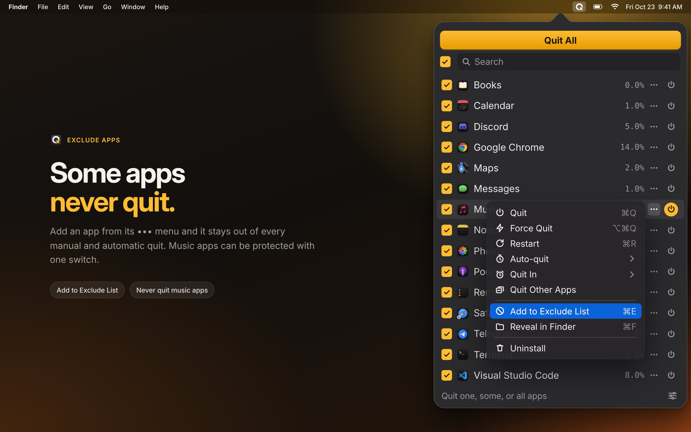
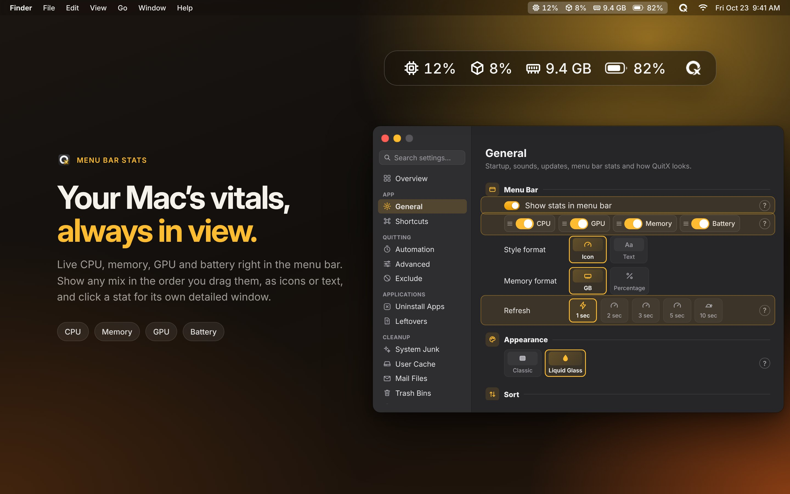
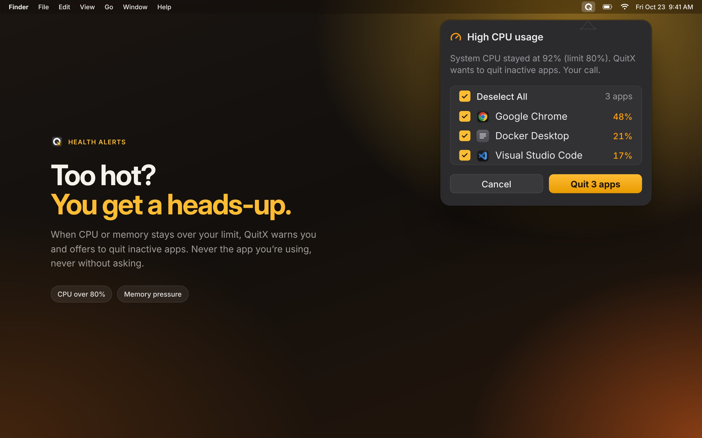
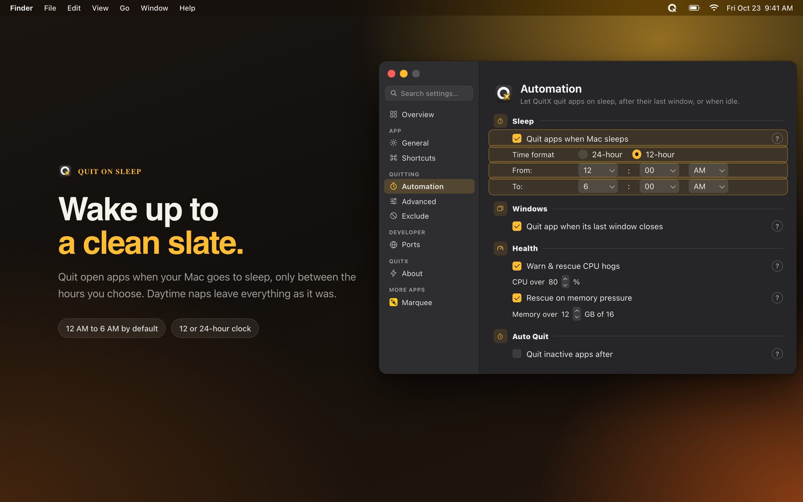
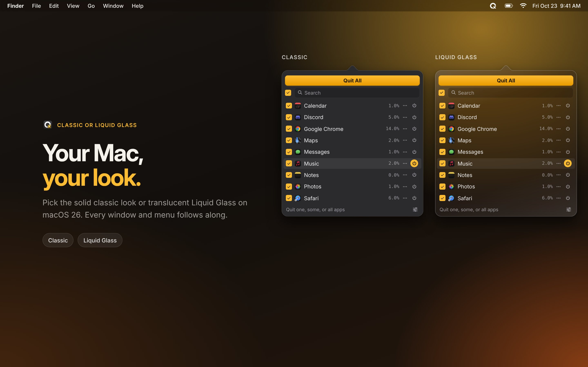
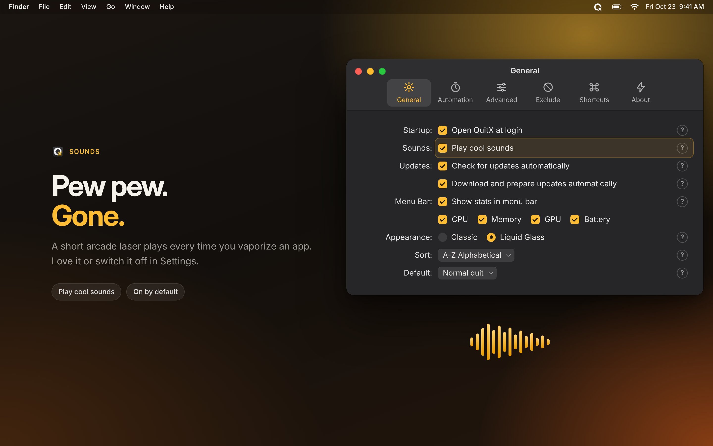
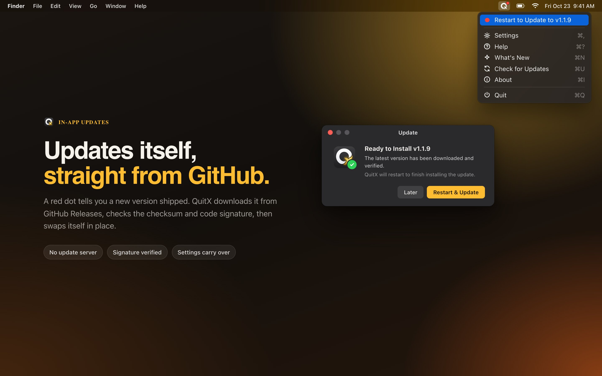

<p align="center">
  
</p>

<h1 align="center">QuitX for macOS</h1>

<p align="center">
  Fast, minimal menu bar companion to quit, force quit, and manage running macOS apps.
</p>

<p align="center">
  <a href="https://github.com/kiron0/quitx/actions/workflows/ci.yml"></a>
  
  
  <a href="LICENSE"></a>
</p>

<p align="center">
  <a href="https://github.com/kiron0/quitx/releases/latest">
    
  </a>
</p>

<p align="center"><a href="https://quitx.kiron.dev">quitx.kiron.dev</a></p>

---

<p align="center">
  
</p>

## Features

| | |
|---|---|
| **Quit one, some, or all** | Every running app in one list, grouped with its windows and helpers. Search, sort by name, CPU or memory. |
| **Confirm before quit** | A quick confirmation before Quit All, and optionally before single quits and restarts. |
| **Normal quit or force quit** | Normal quit lets apps save first. Hold <kbd>⌥</kbd> to force quit, or make Force quit the default. |
| **View background apps** | Show helpers and agents that never appear in the Dock, with identical instances grouped. <kbd>⌘B</kbd> |
| **Exclude apps** | Excluded apps leave the list and are never quit, manually or automatically. Music apps can be protected with one switch. |
| **Menu bar stats** | Live CPU, memory, GPU and battery in the menu bar, as icons or text. Click a stat for a detailed view. |
| **CPU and memory warnings** | When CPU or memory stays over your limit, QuitX notifies you and offers to quit inactive apps. |
| **Quit apps when your Mac sleeps** | Close everything on sleep, only between the hours you pick. |
| **Classic or Liquid Glass** | The solid classic look, or translucent Liquid Glass on macOS 26. |
| **Sounds on quit** | A short arcade laser every time an app goes. Switch it off any time. |
| **Last window closes, app quits** | Close an app's last window and it quits. Spaces, full screen and minimize never count. |
| **Automation** | Quit inactive apps after a while, per-app quit timers, and a battery saver on MacBooks. |
| **Uninstall apps** | Remove one app or several at once with their caches, preferences and support files, preselected with sizes. Confirms first, force quits and moves everything to the Trash. Apple and system apps are never offered. |
| **Global shortcuts** | Open the menu, Quit All or Force Quit All from anywhere. |
| **In-app updates** | Updates straight from GitHub Releases, verified before install. |

<table width="100%">
  <tr>
    <td width="50%"><p align="center"><strong>Normal or force quit</strong></p></td>
    <td width="50%"><p align="center"><strong>Confirm before quit</strong></p></td>
  </tr>
  <tr>
    <td width="50%"><p align="center"><strong>Background apps</strong></p></td>
    <td width="50%"><p align="center"><strong>Exclude apps</strong></p></td>
  </tr>
  <tr>
    <td width="50%"><p align="center"><strong>Menu bar stats</strong></p></td>
    <td width="50%"><p align="center"><strong>CPU and memory warnings</strong></p></td>
  </tr>
  <tr>
    <td width="50%"><p align="center"><strong>Quit on sleep</strong></p></td>
    <td width="50%"><p align="center"><strong>Classic or Liquid Glass</strong></p></td>
  </tr>
  <tr>
    <td width="50%"><p align="center"><strong>Sounds on quit</strong></p></td>
    <td width="50%"><p align="center"><strong>In-app updates</strong></p></td>
  </tr>
</table>

---

## Install

QuitX isn't notarized by Apple (that needs a paid developer account), so macOS asks you to confirm it once. Full walkthrough with screenshots: [quitx.kiron.dev/#install](https://quitx.kiron.dev/#install).

**Terminal** (no prompt): checks the SHA-256 checksum and code signature, installs in `/Applications`, opens QuitX. Don't use `sudo`. [Read the script](site/install).

```bash
curl -fsSL https://quitx.kiron.dev/install | bash
```

**Download**

1. Get the `.dmg` from [Releases](https://github.com/kiron0/quitx/releases/latest) and drag **QuitX** into Applications.
2. Open QuitX. At **“QuitX” Not Opened**, click **Done**.
3. **System Settings › Privacy & Security** › **Open Anyway**, then **Open Anyway** again and your password. On macOS 14, Control-click QuitX › **Open** instead.

<p align="center"></p>

QuitX then updates itself from GitHub Releases (Settings › General).

## License

MIT © [Toufiq Hasan Kiron](https://github.com/kiron0)
